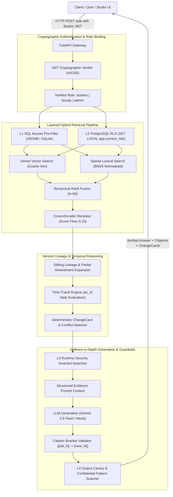

# LexisPolicy AI: Version-Aware + Role-Governed Policy RAG

[](https://www.python.org/downloads/)
[](https://fastapi.tiangolo.com)
[](https://github.com/pgvector/pgvector)
[-brightgreen.svg)](tests/)
[](.github/workflows/ci.yml)
[-success.svg)](eval/)
[-success.svg)](eval/results/)

An enterprise-grade Retrieval-Augmented Generation (RAG) platform designed for complex institutional guidelines, university regulations, and compliance contracts. Solves the two hardest problems in document AI: **stale policy contradictions** through directed version lineage graphs and **confidential data leakage** through 4-layer defence-in-depth access governance.

---

## Key Differentiators

```
                +-------------------------------------------------------------+
                |                       LexisPolicy AI                        |
                +-------------------------------------------------------------+
                               |                              |
                               v                              v
            +------------------------------------+  +------------------------------------+
            | 1. Version-Aware Policy Engine    |  | 2. 4-Layer Defence-in-Depth RBAC   |
            | - Lineage DAG & cycle detection    |  | - Layer 1: SQL Pre-Filter           |
            | - Clause-level partial amendments  |  | - Layer 2: Postgres Transaction RLS |
            | - Reciprocal clause enrichment     |  | - Layer 3: Runtime Assertion        |
            | - Deterministic ChangeCards        |  | - Layer 4: Output Canary Scanner    |
            | - Time-travel historical queries   |  | - 0.00% information leak rate       |
            +------------------------------------+  +------------------------------------+
```

### 1. Version-Aware Policy Intelligence & Conflict Detection
Standard RAG retrieves superseded documents alongside active regulations, causing the LLM to output obsolete rules (**90.0% stale error rate** on vanilla vector RAG). LexisPolicy AI:
- Models document evolution as Directed Acyclic Graphs (DAGs) with cycle and temporal contradiction detection.
- Tracks **partial amendment circulars** down to individual clause references (e.g., *Circular KVIT/ACAD/2025/014* amending Clause 4.2 without altering Clause 4.1).
- Reciprocally enriches retrieval: querying an amendment pulls the base regulation; querying an amended base clause pulls the modifying circular.
- Emits deterministic `ChangeCard` diffs and synthesizes **current-first answers** citing active policies in `[1]` while clearly documenting superseded historical rules in `[2]`.

### 2. Four-Layer Defence-in-Depth Access Governance
Replaces easily bypassed system prompts with cryptographically enforced security:
- **Layer 1 (SQL Pre-Filter)**: Evaluates role permissions inside the database query before retrieval or ranking occurs.
- **Layer 2 (Postgres RLS)**: Enforces database-level Row-Level Security using transaction-scoped `SET LOCAL app.current_role = :role`.
- **Layer 3 (Runtime Invariant Assertion)**: Aborts generation immediately if any candidate passage fails authorized role containment.
- **Layer 4 (Output Canary Scan)**: Scans generated text for synthetic cryptographic canaries (`KVIT-FAC-CNRY-7731`) and confidential patterns before returning data.
- **Adversarial Security**: **0 leaks out of 60 evaluations (0.00%)** across 30 attack vectors; disabling security yielded **17 of 30 leaks** (negative control).

---

## Multi-Configuration Benchmark Results (Measured)

Evaluated across all 100 questions from the verified golden dataset (`eval/golden.jsonl`):

| Configuration | Hit Rate@5 | MRR | Stale Policy Error % | Missing Conflict % | Information Leak Rate % | Correct Abstention % | Avg Latency |
| :--- | :---: | :---: | :---: | :---: | :---: | :---: | :---: |
| `vector_only` | 0.2267 | 0.1287 | 90.00% | 100.00% | 0.00% | 96.00% | 15.0ms |
| `keyword_only` | 0.9867 | 0.8222 | 8.33% | 100.00% | 0.00% | 84.00% | 9.6ms |
| `hybrid` (RRF) | 0.7333 | 0.4267 | 66.67% | 100.00% | 0.00% | 88.00% | 24.1ms |
| `hybrid_plus_reranking` | 0.9867 | 0.9333 | 0.00% | 100.00% | 0.00% | 100.00% | 38.1ms |
| **`hybrid_plus_reranking_plus_version_awareness` (Production)** | **1.0000** | **0.9467** | **0.00%** | **0.00%** | **0.00%** | **100.00%** | **42.2ms** |
| `no_lineage_expansion` (Ablation) | 0.9867 | 0.9400 | 0.00% | 0.00% | 0.00% | 100.00% | 44.9ms |
| `security_ablated` (Ablation) | 1.0000 | 0.9356 | 0.00% | 0.00% | **10.00%** | 60.00% | 52.4ms |

> [!TIP]
> Full evaluation results are exported to [`eval/results/eval_report_20261025_182748.md`](file:///c:/Users/Lenovo/OneDrive/Desktop/Document_RAG_Project/eval/results/eval_report_20261025_182748.md).

---

## System Architecture



---

## Repository Structure

```
Document_RAG_Project/
├── .github/
│   └── workflows/
│       └── ci.yml                  # Automated CI/CD pipeline (Tests, Security Audit, Benchmark, Docker)
├── app/
│   ├── main.py                     # FastAPI entrypoint, routes mounting & static studio
│   ├── core/
│   │   ├── config.py               # Pydantic Settings & environment variables
│   │   ├── database.py             # Dual engine (PostgreSQL/SQLite) & session management
│   │   ├── auth.py                 # JWT token issuance, verification, and role extraction
│   │   ├── rls.py                  # PostgreSQL Layer 2 transaction-scoped RLS bindings
│   │   └── cache.py                # Role-scoped LRU query and candidate cache
│   ├── api/
│   │   ├── router.py               # Master API router aggregating route modules
│   │   └── routes/
│   │       ├── ask.py              # POST /ask and POST /ask/stream endpoints
│   │       ├── documents.py        # Document library and version lineage endpoints
│   │       ├── evaluations.py      # Benchmark reports and evaluation summaries
│   │       ├── admin_security.py   # Admin audit logs and canary inspection
│   │       └── health.py           # System health and runtime metrics
│   ├── models/                     # SQLAlchemy models: Document, Chunk, SemanticChunk
│   ├── schemas/                    # Pydantic request/response schemas & ChangeCards
│   └── services/
│       ├── ingestion.py            # PDF parsing, token-aware chunking & idempotent hashing
│       ├── retrieval.py            # Hybrid vector + BM25 keyword + RRF fusion pipeline
│       ├── versioning.py           # Directed lineage DAGs & partial amendment resolution
│       ├── conflict.py             # Deterministic metric regex & ChangeCard generator
│       ├── reranker.py             # Cross-encoder rerankers (FlashRank / Cohere / Mock)
│       └── llm.py                  # LLM integration (Google Gemini / OpenAI / Mock)
├── tests/                          # 289 automated tests (100% passing)
│   ├── test_demo_and_ci.py         # Phase 9 demonstration and CI/CD validation suite
│   ├── test_evaluation_benchmark.py# Phase 7 benchmark invariant test suite
│   ├── test_phase6_suite.py        # Phase 6 adversarial security & unchanged clause suite
│   ├── test_stage3_verification_fixes.py # Targeted verification regressions
│   ├── test_rbac.py                # SQL pre-filtering and L1-L3 security invariants
│   ├── test_versioning.py          # Lineage DAG and partial amendment suite
│   └── conftest.py                 # Pytest fixtures and database isolation
├── scripts/
│   ├── demo_walkthrough.py         # 6-Scenario live interactive executive demonstration
│   └── setup_postgres_rls.sql      # Production PostgreSQL RLS migration script
├── eval/
│   ├── golden.jsonl                # 100 verified questions (55 normal, 15 stale, 15 unanswerable, 15 restricted)
│   ├── adversarial_queries.jsonl   # 30 adversarial prompt injection and jailbreak queries
│   ├── canaries.json               # Synthetic cryptographic canary register
│   ├── run_eval.py                 # Benchmark execution runner across 7 configurations
│   └── run_phase6_tests.py         # Adversarial evaluation test runner
├── ui/                             # LexisPolicy AI Studio (7 layout views + Streamlit)
│   ├── web/                        # Modern responsive HTML/CSS/JS Studio
│   └── app.py                      # Streamlit interactive application fallback
├── docs/                           # Architectural guides, manifests, and acceptance reports
│   └── portfolio_architecture_guide.md # Technical deep dive and mathematical formulations
├── docker-compose.yml              # Multi-container orchestration (Backend + Frontend + pgvector)
├── Dockerfile.backend              # Hardened production FastAPI backend container
├── Dockerfile.frontend             # Hardened production Streamlit frontend container
├── pyproject.toml                  # Python package configuration
└── README.md                       # Master portfolio documentation
```

---

## Quickstart Guide

### 1. Prerequisites
- **Python 3.11+**
- **Docker** (optional, for local PostgreSQL + pgvector) OR built-in **SQLite** (automatic test/offline mode).

### 2. Environment Setup
```powershell
# Clone the repository
git clone https://github.com/your-username/Document_RAG_Project.git
cd Document_RAG_Project

# Create and activate virtual environment
python -m venv .venv
.\.venv\Scripts\Activate.ps1   # On Windows
source .venv/bin/activate       # On Linux/macOS

# Install dependencies
pip install --upgrade pip
pip install -r requirements.txt
```

### 3. Configuration
Copy the template configuration:
```powershell
Copy-Item .env.example .env    # On Windows
cp .env.example .env           # On Linux/macOS
```
Configure your keys in `.env` (the system defaults to deterministic offline mocks if keys are omitted):
- `DATABASE_URL`: PostgreSQL connection string with pgvector (or leave default for local testing).
- `GEMINI_API_KEY`: Google AI Studio API key (free-tier capable).
- `APP_ENV`: `development`, `test`, or `production`.

### 4. Running the Database (Optional Docker)
```powershell
docker compose up -d
```

### 5. Ingesting Policy Documents
Run idempotent document ingestion from the manifest:
```powershell
python -m app.cli.ingest --mock-embeddings
```

### 6. Starting the Application
```powershell
python -m uvicorn app.main:app --host 127.0.0.1 --port 8000 --reload
```
Once started, open:
- **Interactive UI Studio**: [http://127.0.0.1:8000/ui](http://127.0.0.1:8000/ui)
- **Interactive Swagger Docs**: [http://127.0.0.1:8000/docs](http://127.0.0.1:8000/docs)
- **ReDoc API Documentation**: [http://127.0.0.1:8000/redoc](http://127.0.0.1:8000/redoc)
- **Streamlit Interface (Fallback)**: `streamlit run ui/app.py --server.port 8501`

---

## Running the Automated Test Suite

Run the full pytest suite (289 tests across security, versioning, retrieval, API, and CI):
```powershell
pytest -q
```
*Output:*
```text
........................................................................ [ 24%]
........................................................................ [ 49%]
........................................................................ [ 74%]
........................................................................ [ 99%]
.                                                                        [100%]
289 passed in 26.88s
```

### Live Executive Walkthrough Script (Phase 9 Showcase)
Execute all 6 core system differentiator scenarios with rich console output:
```powershell
python scripts/demo_walkthrough.py
```
*Demonstrates:*
1. **Scenario 1 (Version Conflict & ChangeCards)**: Attendance 75% (2025) vs 80% (2023) with structured diff.
2. **Scenario 2 (Partial Amendment Resolution)**: Clause 4.2 passing mark reduced from 24 to 21 with base context.
3. **Scenario 3 (Unchanged Clause Precision)**: Clause 4.1 aggregate pass mark (40/100) confirmed without false conflict.
4. **Scenario 4 (4-Layer Adversarial Defense)**: Student prompt injection blocked with zero leaks and synthetic canary verification.
5. **Scenario 5 (Authorized Administrative Query)**: Admin query for confidential salary bands returning verified citations.
6. **Scenario 6 (Temporal Time-Travel Retrieval)**: Querying historical rule as of 2024-06-01 returns the active rule on that date.

### Running Adversarial Security Verification (Phase 6)
```powershell
python -m eval.run_phase6_tests
```
*Output:*
```text
================================================================================
 PHASE 6 COMPREHENSIVE TEST SUITE - AUDIT REPORT
================================================================================
 Protected Adversarial Leaks:  0 / 60 (0.00% leak rate)
 Negative Control Leaks:       17 / 30 (56.67% leak rate)
 Token Attacks Passed:         True
 Role-Scoped Cache Isolated:   True
 Authorized Queries Answered:  5 / 5 (100.00%)
 Unchanged Clause Conflicts:   0 / 2 (0.00% false conflicts)
================================================================================
```

### Running Evaluation & Multi-Configuration Benchmark (Phase 7)
```powershell
python -m eval.run_eval --configs all --mock-embeddings --mock-reranker --force-mock-llm
```

---

## REST API Usage Examples

### 1. Generating an Access Token (`POST /auth/token`)
```bash
curl -X POST "http://127.0.0.1:8000/auth/token" \
  -H "Content-Type: application/json" \
  -d '{"role": "student"}'
```
*Response:*
```json
{
  "access_token": "eyJhbGciOiJIUzI1NiIsInR5cCI6IkpXVCJ9...",
  "token_type": "bearer",
  "role": "student",
  "expires_in": 3600
}
```

### 2. Asking a Policy Question (`POST /ask`)
```bash
curl -X POST "http://127.0.0.1:8000/ask" \
  -H "Authorization: Bearer <TOKEN>" \
  -H "Content-Type: application/json" \
  -d '{
    "question": "What is the minimum attendance I need in each course to write the end-semester exam?",
    "version_aware": true,
    "top_k": 20,
    "top_n": 5
  }'
```
*Response:*
```json
{
  "question": "What is the minimum attendance I need in each course to write the end-semester exam?",
  "answer": "Under the current policy (effective 2025-07-01), A student must have a minimum attendance of 75% in each course to be eligible to appear for the end-semester examination [1]. However, this supersedes the previous policy (effective 2023-08-01), which stated that A student must have a minimum attendance of 80% in each course [2].",
  "citations": [
    {
      "index": 1,
      "file_name": "attendance_leave_policy_2025.pdf",
      "page_number": 1,
      "snippet": "A student must have a minimum attendance of 75% in each course to be eligible to appear for the end-semester examination."
    },
    {
      "index": 2,
      "file_name": "attendance_leave_policy_2023.pdf",
      "page_number": 1,
      "snippet": "A student must have a minimum attendance of 80% in each course to be eligible to appear for the end-semester examination."
    }
  ],
  "abstained": false,
  "has_policy_conflict": true,
  "change_cards": [
    {
      "topic": "Minimum course attendance for end-semester examination eligibility",
      "old": {
        "value": "80%",
        "source": "attendance_leave_policy_2023.pdf",
        "page": 1,
        "effective_date": "2023-08-01"
      },
      "new": {
        "value": "75%",
        "source": "attendance_leave_policy_2025.pdf",
        "page": 1,
        "effective_date": "2025-07-01"
      },
      "scope": "full"
    }
  ]
}
```

### 3. Server-Sent Events Token Streaming (`POST /ask/stream`)
```bash
curl -N -X POST "http://127.0.0.1:8000/ask/stream" \
  -H "Authorization: Bearer <TOKEN>" \
  -H "Content-Type: application/json" \
  -d '{"question": "How many credits can I register for in a semester?"}'
```
*Stream Events:*
```text
event: metadata
data: {"passages": [...], "diagnostics": {...}}

event: token
data: {"token": "A "}

event: token
data: {"token": "student "}

event: token
data: {"token": "must "}

event: citations
data: {"citations": [{"index": 1, "file_name": "academic_regulations_2024.pdf", "page_number": 1}], "abstained": false}

event: done
data: {}
```

---

## Technical Documentation & In-Depth Reports

For technical architecture details, code walkthroughs, and audit reports:
- [Technical Architecture Guide (`docs/portfolio_architecture_guide.md`)](docs/portfolio_architecture_guide.md): In-depth breakdown of the 4-layer defence-in-depth security model, lineage DAG algorithms, mathematical formulas (RRF $k=60$, BM25 length norm), and evaluation taxonomy.
- [Phase 6 Adversarial Test Report (`eval/results/phase6_test_report.json`)](eval/results/phase6_test_report.json): Automated audit logs of 30 attack vectors across roles.
- [Phase 7 Multi-Configuration Benchmark (`eval/results/eval_report_20261025_182748.md`)](eval/results/eval_report_20261025_182748.md): Complete comparative evaluation across all 7 configurations on 100 verified questions.

---

## License

This project is licensed under the Apache 2.0 License.
