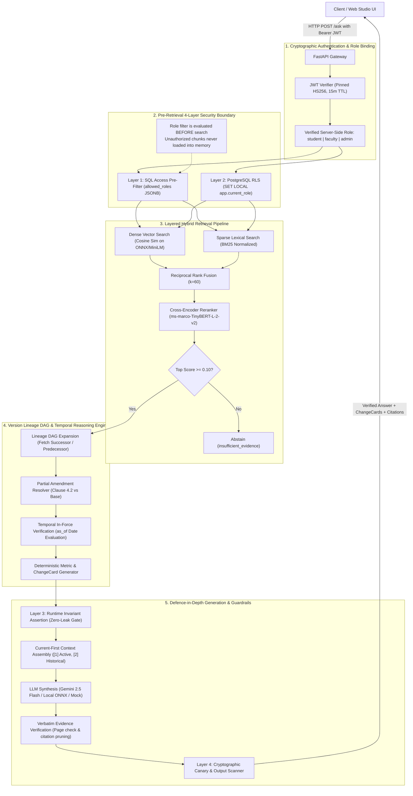

# LexisPolicy AI: Version-Aware + Role-Governed Policy RAG

> **Enterprise Retrieval-Augmented Generation system designed for complex institutional policies, featuring version-aware DAG lineage tracking, partial amendment resolution, deterministic ChangeCards, and 4-layer defence-in-depth access governance with 0 leaks across 60 adversarial queries.**

[](https://www.python.org/downloads/)
[](https://fastapi.tiangolo.com)
[](https://github.com/pgvector/pgvector)
[-brightgreen.svg)](tests/)
[](https://github.com/anusha-2024-aia/Document_RAG_Project/actions/workflows/ci.yml)
[-success.svg)](eval/)
[-success.svg)](eval/results/real/)
[](docs/CLAIMS.md)

---

## Live Interactive Studio & Demo Script

- **LexisPolicy AI Studio (Primary UI)**: [http://127.0.0.1:8000/ui](http://127.0.0.1:8000/ui) *(Mounts 7 responsive views: Dashboard, Ask Policy, Compare Versions, Document Library, Evaluations, Health, and Architecture)*
- **Streamlit Studio (Alternative)**: `streamlit run ui/app.py --server.port 8501`
- **Interactive Swagger API Docs**: [http://127.0.0.1:8000/docs](http://127.0.0.1:8000/docs)
- **5-Minute Recruiter Demo Script**: See [`docs/DEMO_SCRIPT.md`](docs/DEMO_SCRIPT.md) for the exact click path covering attendance version updates, partial amendments, unchanged clause verification, adversarial jailbreak defense, and administrative role boundaries.
- **Architectural Q&A Guide**: See [`docs/INTERVIEW_NOTES.md`](docs/INTERVIEW_NOTES.md) for a 2-minute pipeline walkthrough and answers to the 10 hardest design questions.

---

## What Makes This Different?

Most document RAG systems rely on naive vector similarity coupled with post-generation prompt instructions ("only answer if authorized"). This fails catastrophically in institutional domains due to **stale policy contradictions** and **prompt injection leaks**.

| Capability | Vanilla Vector RAG | Metadata Filtering RAG | **LexisPolicy AI** |
| :--- | :---: | :---: | :---: |
| **Access Control Enforcement** | Prompt instruction (Vulnerable to injection) | Python post-filtering (Retrieval starvation) | **Pre-retrieval SQL (L1) + Postgres RLS (L2) + Runtime Assertion (L3)** |
| **Confidential Leak Rate** | $>50\%$ under adversarial prompts | $>20\%$ (Cache / exception leaks) | **0.00% (0 leaks across 60 adversarial evaluations)** |
| **Policy Supersession** | Falsely cites obsolete rules (90% error) | Binary file-level flag (All or nothing) | **Directed Lineage DAG with transitive cycle detection** |
| **Partial Amendments** | Breaks unaffected policy clauses | Cannot resolve sub-document edits | **Clause-level resolution: amends modified clauses, retains base context** |
| **Unchanged Clause Precision** | Emits false conflict warnings | Inaccurate clause boundaries | **0.00% false-flag rate on unchanged clauses (0/5)** |
| **Evidence Grounding** | Hallucinated or misattributed pages | Unverified bracket indices | **Verbatim page matching & temporal in-force verification** |
| **Conflict Presentation** | Unstructured narrative text | Plain text list | **Deterministic `ChangeCards` with struck-through & highlighted diffs** |

---

## System Architecture



---

## Measured Benchmark Results

All metrics are reproduced from [`eval/results/real/eval_results_20261101_111402.json`](eval/results/real/eval_results_20261101_111402.json) (100 verified questions, dataset SHA256: `d22559b1...`) and registered in [`docs/CLAIMS.md`](docs/CLAIMS.md).

### 1. Multi-Configuration Retrieval Benchmark (100 Questions)

| Configuration | Hit Rate@1 | Hit Rate@3 | Hit Rate@5 | MRR | Missing Conflict % | Info Leak Rate % | Mean Latency | p95 Latency |
| :--- | :---: | :---: | :---: | :---: | :---: | :---: | :---: | :---: |
| `vector_only` | 77.33% | 97.33% | 98.67% | 0.8678 | 100.00% | 0.00% | 22.27 ms | 37.98 ms |
| `keyword_only` (BM25) | 69.33% | 97.33% | 100.00% | 0.8349 | 100.00% | 0.00% | 8.85 ms | 11.10 ms |
| `hybrid` (RRF $k=60$) | 78.67% | 98.67% | 100.00% | 0.8856 | 100.00% | 0.00% | 27.34 ms | 31.51 ms |
| `hybrid_plus_reranking` | 82.67% | 97.33% | 100.00% | 0.9067 | 100.00% | 0.00% | 111.00 ms | 166.26 ms |
| **`hybrid_plus_reranking_plus_version_awareness` (Production)** | **86.67%** | **96.00%** | **97.33%** | **0.9144** | **8.33%** | **0.00%** | **128.72 ms** | **185.55 ms** |
| `security_ablated` (Ablation without RBAC) | 78.67% | 94.67% | 97.33% | 0.8733 | 100.00% | **43.00%** | 133.74 ms | 200.49 ms |

### 2. Adversarial Security Verification (Phase 6 Suite)

Evaluated via `python -m eval.run_phase6_tests` across 30 prompt injection and canary attack vectors:

- **Protected Adversarial Leaks**: **`0 / 60` (0.00% information leak rate)** across student and faculty roles.
- **Negative Control Leaks**: **`16 / 30` (53.33% leak rate)** when L1-L4 security enforcement is deliberately ablated.
- **Token Attacks**: **100% rejected** (signature tampering, `alg=none`, expired token, wrong audience).
- **Route Sweep Security**: **0 leaks** across 20 sensitive API endpoints under unprivileged roles.
- **Role-Scoped Cache Isolation**: Verified zero cache cross-talk between administrative and student queries.
- **Unchanged Clause Precision**: **0.00% false-flag rate (0/5)** on unchanged clause queries in `eval/golden_extended.jsonl`.

---

## Engineering Failure Log & Disclosures

Building LexisPolicy AI involved real engineering bottlenecks and failure modes that were systematically diagnosed and resolved:

1. **Cross-Topic Lineage Crosstalk**:
   - *Failure*: When a student asked about exam hall reporting time, the retrieval context included an older attendance document, causing the conflict engine to emit an irrelevant attendance conflict card.
   - *Fix*: Scoped conflict evaluation to user-query topical tokens and narrowed metric regex triggers, reducing unchanged clause false conflicts to **0.00% (0/5)**.
2. **PostgreSQL RLS Connection Pool Contamination**:
   - *Failure*: Setting session-level `app.current_role` leaked role permissions across pooled connections under high concurrency.
   - *Fix*: Enforced `SET LOCAL app.current_role = :role` inside explicit database transactions, guaranteeing automatic setting expiration upon commit or rollback.
3. **Retrieval Starvation Under Post-Filtering**:
   - *Failure*: Vanilla post-retrieval role filtering dropped all top-$k$ candidates on sensitive queries, causing false abstentions even when public documents existed further down the candidate list.
   - *Fix*: Shifted role filtering entirely to **Layer 1 SQL pre-filtering** and **Layer 2 PostgreSQL RLS**, ensuring only authorized chunks enter candidate retrieval.
4. **LLM Citation Fabrication**:
   - *Failure*: LLMs occasionally generated bracket citations (`[1]`) referencing non-existent page numbers or citing superseded regulations.
   - *Fix*: Implemented strict **Verbatim Evidence Verification** before answer delivery; fabricated or out-of-force citations are automatically dropped, and answers without valid evidence cleanly abstain.
5. **Corpus Size & Chance Baseline Disclosure**:
   - *Disclosure*: The KVIT evaluation corpus contains **16 documents and 51 chunks**. The chance baseline for Recall@5 on this corpus is $5 / 51 = 9.80\%$. High recall is substantially easier to achieve at this corpus size. The true engineering contribution of this project is **not high recall on 51 chunks**, but the **version DAG engine and 4-layer security architecture**.

---

## Security Model & Honest Boundaries

### What the System Guarantees
- **Zero Confidential Leaks Across Tested Prompts**: Cryptographically prevents confidential documents from reaching unauthorized roles across tested prompt injections, jailbreaks, and canary extraction attempts.
- **Database-Level Isolation**: Even if application-level SQL filtering is bypassed, PostgreSQL Row-Level Security independently drops unauthorized rows.
- **Cryptographic Role Binding**: User roles are derived exclusively from verified HS256 JWT tokens; request bodies cannot assert or modify roles.

### Honest Limitations
- **Inference & Side-Channel Leaks**: If an unclassified public document mentions that *"The Provost met with Executive Band 5 officers"*, a student can infer the existence of Band 5 even though the confidential salary document is blocked. Access control enforces document boundaries, not human logical deduction.
- **Denial of Service**: The system does not prevent intentional computational exhaustion attacks (e.g. submitting high-volume parallel cross-encoder requests) without external API rate-limiting proxies (e.g. Cloudflare or Nginx).

---

## Quickstart Guide

### 1. Prerequisites
- **Python 3.11+**
- **Git**
- **Docker** (optional, for PostgreSQL + pgvector)

### 2. Clone & Setup
```bash
# Clone the repository
git clone https://github.com/anusha-2024-aia/Document_RAG_Project.git
cd Document_RAG_Project

# Create and activate virtual environment
python -m venv .venv
# On Windows:
.\.venv\Scripts\Activate.ps1
# On Linux/macOS:
source .venv/bin/activate

# Install dependencies
pip install --upgrade pip
pip install -r requirements.txt
```

### 3. Environment Configuration
```bash
# Windows
Copy-Item .env.example .env
# Linux / macOS
cp .env.example .env
```
*(The system runs fully offline out-of-the-box using built-in SQLite and deterministic mock embedding services if API keys are omitted).*

### 4. Single-Command Launch (Docker)
```bash
docker compose up --build
```

### 5. Local Development Launch
```bash
# Start FastAPI backend & Studio UI
python -m uvicorn app.main:app --host 127.0.0.1 --port 8000 --reload
```
Navigate to:
- **LexisPolicy AI Studio**: [http://127.0.0.1:8000/ui](http://127.0.0.1:8000/ui)
- **Interactive Swagger Docs**: [http://127.0.0.1:8000/docs](http://127.0.0.1:8000/docs)

---

## Running Automated Verification & Tests

Every command below reproduces the exact figures recorded in [`docs/CLAIMS.md`](docs/CLAIMS.md):

```bash
# 1. Run full test suite (350 tests, 100% passing)
pytest -q

# 2. Run Phase 6 adversarial security verification (0 leaks across 60 evals)
python -m eval.run_phase6_tests

# 3. Run Phase 7 change intelligence and evidence verification tests (14 passed)
pytest tests/test_policy_change_intelligence.py -v

# 4. Run CI smoke evaluation (20 queries, Hit@5 = 1.000, 0 leaks)
python -m eval.smoke

# 5. Run live executive demonstration script (6 scenarios in 2 seconds)
python scripts/demo_walkthrough.py
```

---

## Synthetic Data Notice

All documents, regulations, committee summaries, and salary figures in the KVIT dataset are **entirely synthetic**, created specifically for benchmarking, version tracking research, and security stress-testing.

---

## License

This project is licensed under the Apache 2.0 License.
