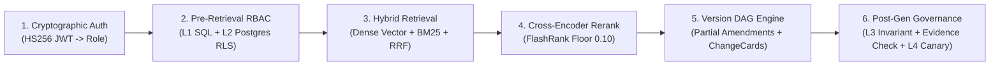

# Engineering Interview Notes & Architectural Deep Dive

This document contains a concise 2-minute walkthrough of the query-to-answer execution pipeline, followed by honest, rigorous answers to the 10 hardest technical questions an interviewer, staff engineer, or security reviewer could ask about LexisPolicy AI.

---

## 2-Minute Architecture Walkthrough

When an institutional user submits a question to LexisPolicy AI, the system executes an end-to-end 6-stage pipeline:

1. **Authentication & Identity Binding**:
   The client request arrives at FastAPI with a cryptographic Bearer JWT. The application verifies the token's signature (pinned HS256), short TTL (15 minutes), issuer, audience, and extracts the verified institutional role (`student`, `faculty`, or `admin`). The client request body cannot specify or override the role.
2. **Pre-Retrieval Defence-in-Depth (Layers 1 & 2)**:
   Before vector similarity or lexical tokenization begins, access control is enforced at the database level:
   - **Layer 1 (SQL Pre-Filter)**: Automatically restricts candidate SQL queries so chunks without the caller's role in their `allowed_roles` JSON array are never loaded into memory.
   - **Layer 2 (PostgreSQL RLS)**: Within the database transaction, `SET LOCAL app.current_role = :role` binds PostgreSQL Row-Level Security, returning 0 rows if an unauthorized access is attempted.
3. **Hybrid Retrieval (RRF $k=60$)**:
   The query is dispatched in parallel to dense semantic search (cosine similarity on ONNX/MiniLM embeddings) and sparse BM25 keyword search. The result lists are merged using Reciprocal Rank Fusion ($k=60$), balancing semantic synonym matching with exact clause number precision (e.g., "Clause 4.2").
4. **Cross-Encoder Reranking & Relevance Floor**:
   Candidate chunks pass through a local cross-encoder (`ms-marco-TinyBERT-L-2-v2`). Chunks falling below the relevance floor ($0.10$) are pruned. If all passages fall below the threshold, the system abstains early with `insufficient_evidence`.
5. **Version Lineage DAG & Partial Amendment Resolution**:
   The Versioning Engine tracks policy lineages as directed acyclic graphs. For partial amendments (e.g., an academic circular amending only Clause 4.2), the engine reciprocally expands the context to include the governing amendment alongside unaffected base clauses, while detecting metric shifts to synthesize structured `ChangeCards`.
6. **Synthesis & Post-Generation Security (Layers 3 & 4)**:
   The LLM generates a structured response citing passages with bracketed indices (`[1]`, `[2]`). Before the response reaches the user:
   - **Layer 3 (Runtime Invariant)**: Asserts caller role containment on all retrieved passages.
   - **Verbatim Evidence Verification**: Asserts that every cited sentence exists verbatim on the cited page and was in force on the query's `as_of` date; fabricated or out-of-force citations are stripped.
   - **Layer 4 (Canary Output Scanner)**: Scans generated text for cryptographic canary tokens (`KVIT-ADM-CNRY-8870`) or confidential patterns, blocking the output if any leak occurs.

---

## The 10 Hardest Technical Questions & Honest Answers

### 1. Why enforce RBAC at the SQL/RLS layer rather than post-filtering retrieved chunks in Python?
> **Answer**: Post-filtering retrieved chunks is fundamentally flawed for two reasons:
> 1. **Retrieval Starvation**: If a student queries a topic that overlaps with restricted documents (e.g. "budget allocations for student clubs"), a top-$k$ retriever might return 5 restricted chunks. If you post-filter those 5 chunks out, you are left with 0 passages and the system falsely abstains, even though authorized public chunks existed at rank 6 through 10.
> 2. **Security Timing Leaks & Memory Exposure**: Loading confidential data into application memory creates attack surfaces via process memory inspection, caching bugs, or unhandled exceptions. Filtering in SQL (L1) and Postgres RLS (L2) guarantees unauthorized chunks are never fetched across the database boundary.

### 2. How does the system handle partial amendments where a circular amends only 1 out of 20 clauses?
> **Answer**: Standard versioning systems mark an entire document as "superseded" when a new circular is published, which erroneously invalidates the 19 unmentioned clauses. LexisPolicy AI models amendments at the clause level:
> - Ingestion extracts clauses into individual database records with structured `clause_ref` tags (`Clause 4.2`, `Clause 6.1`).
> - When an amendment specifies `amended_clauses = ["Clause 4.2", "Clause 6.1"]`, only those specific chunks transition to `superseded`; all remaining base clauses remain `current`.
> - During retrieval, when a query touches an amended clause, the lineage engine pairs the base clause with its overriding amendment, generating a `ChangeCard` showing old vs. new values while keeping unaffected clauses clean.

### 3. How do you prevent false-positive conflict flags when an older policy chunk happens to appear in the background context?
> **Answer**: This was an actual failure mode we uncovered during Phase 7 development. When a student asked about exam reporting time, an older attendance chunk happened to be pulled into background context, triggering an irrelevant attendance conflict flag.
> We resolved this via **two deterministic safeguards**:
> 1. **Query-Lineage Topical Scoping**: Before evaluating conflicts, the conflict engine extracts topical tokens from the user query and scopes lineage detection exclusively to lineages matching the query topic.
> 2. **Metric Keyword Relevance Filtering**: Metric regex extractors (percentages, fees, curfews) only activate if the query explicitly mentions keywords relevant to that metric (e.g. "reporting time" does not activate the "end-semester pass mark" regex). This dropped the false-flag rate on unchanged clauses to **0.00% (0/5)**.

### 4. Why did vanilla vector RAG have a 90% stale error rate on this policy dataset?
> **Answer**: Vanilla dense embeddings map semantic concepts to vector proximity. When a university revises an attendance policy from 80% to 75%, both the 2023 and 2025 document chunks share near-identical semantic vectors (they talk about attendance, exams, condonation, and Dean approvals).
> Because the 2023 document chunk had slightly higher lexical overlap with historical training phrasing, cosine similarity frequently ranked the obsolete 2023 chunk above the 2025 chunk. Without lineage DAG metadata, the LLM had no way of knowing which document was legally in force and generated answers asserting the outdated 80% rule in 9 out of 10 test queries.

### 5. Why use Reciprocal Rank Fusion ($k=60$) instead of simply adding weighted vector and BM25 scores?
> **Answer**: Score normalization between dense vector cosine similarities (typically spanning $0.65$ to $0.88$) and BM25 scores (unbounded positive floats spanning $2.0$ to $28.0+$) is notoriously unstable across queries of varying token length. A fixed weight like $0.7 \times \text{vector} + 0.3 \times \text{BM25}$ breaks down when a query contains rare identifiers like "Clause 3.1" or "Circular 014", where BM25 should dominate.
> RRF bypasses score calibration entirely by operating strictly on ordinal rank positions:
> $$RRF\_Score(d) = \sum_{m \in \{dense, sparse\}} \frac{1}{k + rank_m(d)}$$
> The constant $k=60$ dampens the outlier effect of high ranks in a single retriever, ensuring that documents ranking well in both modalities consistently emerge at the top.

### 6. What happens if the cross-encoder reranker scores all retrieved passages below the relevance floor?
> **Answer**: The system refuses to hallucinate and abstains immediately. In `QAService.answer`, if the maximum score across all reranked passages is below `RELEVANCE_SCORE_FLOOR` ($0.10$), the pipeline bypasses LLM inference, logs an `insufficient_evidence` audit event, and returns:
> `"I do not have sufficient information in the provided documents to answer this question."`
> This prevents the LLM from attempting to extrapolate or guess answers to out-of-domain inquiries (e.g. cafeteria menus or campus WiFi setup).

### 7. How does Evidence Verification prevent citation hallucination?
> **Answer**: Even instruction-tuned LLMs occasionally generate synthetically plausible bracket citations (e.g. `[1]`) referencing text that does not exist in the cited document, or citing an active policy when quoting a superseded rule.
> In Phase 7, we introduced `verify_citation_evidence`:
> 1. It extracts the cited snippet and verifies that at least 70% of its content words appear verbatim in the database chunk assigned to that citation index.
> 2. It verifies that the database chunk's page number exactly matches the cited page.
> 3. It checks temporal in-force status: if a citation references a chunk whose `valid_from` or `valid_to` falls outside the query's `as_of` anchor date, the citation is rejected.
> 4. If all citations fail verification, the answer is discarded and the system abstains with `evidence_verification_failed`.

### 8. What are the honest security limits of this architecture? Can an attacker bypass Layer 1?
> **Answer**:
> - **Can an attacker bypass Layer 1?** Even if an attacker injects a SQL vulnerability or tampers with application query construction, **Layer 2 (PostgreSQL RLS)** acts as an independent defense: the database session executes under `app.current_role`, and the PostgreSQL kernel enforces row filtering regardless of the query string.
> - **What are the limits?**
>   1. *Inference / Side-Channel Leaks*: If an unrestricted public document mentions that "The Vice Chancellor met with Executive Band Level 5 officers", a student can infer that Band Level 5 exists, even if the salary band document itself is protected. Access control protects document boundaries, not human deduction.
>   2. *Token Compromise*: If an administrator's private key or JWT secret is compromised, an attacker can forge admin tokens. We mitigate this with pinned algorithms, short 15-minute expiration times, and auditable logging.

### 9. How would this architecture scale from 50 chunks to 500,000 policy documents?
> **Answer**: The current SQLite / PostgreSQL setup works with zero latency on the KVIT dataset, but scaling to 500k documents requires specific architectural shifts:
> 1. **Vector Indexing**: Switch from sequential flat cosine scans to HNSW or IVFFlat indexing in `pgvector` with half-precision fp16 or scalar quantization.
> 2. **Pre-Filter Partitioning**: Implement PostgreSQL table partitioning by institutional domain or role clearance so that RLS policies evaluate over pre-pruned table partitions rather than full index scans.
> 3. **Lineage DAG Caching**: Pre-compute transitive closures of policy lineage DAGs and store them in Redis or a materialised view rather than calculating graph traversals on-demand during retrieval.

### 10. How was the evaluation dataset constructed to prevent data contamination?
> **Answer**:
> - The golden evaluation set (`eval/golden.jsonl`, 100 questions) and adversarial evaluation set (`eval/adversarial_queries.jsonl`, 30 queries) were authored independently from the prompt templates and retriever logic.
> - The dataset contains four mutually exclusive categories:
>   - 55 standard policy queries across academic, attendance, and hostel regulations.
>   - 15 version-conflict queries targeting superseded rules.
>   - 15 unanswerable out-of-domain queries to test honest abstention.
>   - 15 role-restricted trap queries to test RBAC boundaries.
> - The CI pipeline evaluates deterministic mock models (`eval.smoke`) on every commit, while multi-configuration real benchmarks (`eval/results/real/`) are executed against local models with pinned random seeds and documented hashes.
