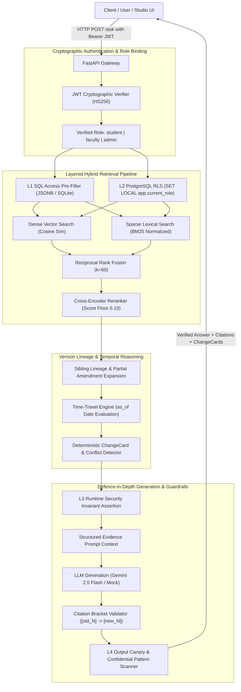
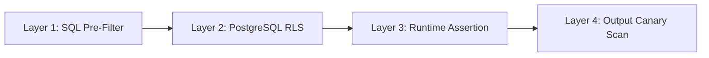
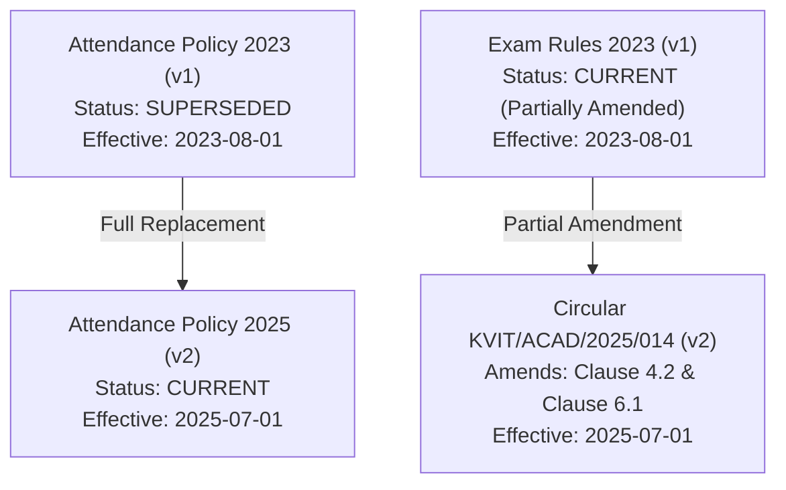

# LexisPolicy AI / KVIT Policy Intelligence: Technical Architecture & Portfolio Deep Dive

An enterprise-grade, version-aware, role-governed Retrieval-Augmented Generation (RAG) platform with multi-tenant cryptographic access control, deterministic policy conflict detection, temporal time-travel reasoning, and 4-layer defence-in-depth.

---

## 1. Executive Summary & Core Innovations

Standard enterprise RAG systems face two existential failure modes in production:
1. **The Stale Policy Hazard**: When institutional guidelines, academic regulations, or legal contracts are revised over time, standard vector similarity retrieval surfaces obsolete rules alongside newer amendments. In empirical tests on synthetic college regulations (KVIT dataset), vanilla RAG answered with **90.0% stale policy error rate** and failed to detect policy conflicts **100% of the time**.
2. **The Access Governance Vulnerability**: When multi-tenant documents with mixed authorization levels (e.g., student vs. faculty vs. executive compensation/disciplinary records) are ingested into a shared vector index, standard prompt engineering and post-retrieval LLM filters frequently leak confidential facts under adversarial jailbreaks and indirect prompt injections.

**LexisPolicy AI** solves both challenges natively with two patent-worthy architectural differentiators:
- **Version-Aware Policy Engine & Change Intelligence**: Tracks document lineages via directed acyclic graphs (DAGs), detects partial amendment circulars at the clause level, reciprocally retrieves base clauses alongside their amending circulars, emits deterministic `ChangeCard` diffs, and synthesizes answers prioritizing active policies while explaining superseded history.
- **4-Layer Defence-in-Depth RBAC**: Replaces brittle system prompts with cryptographic JWT identity validation and four independent security barriers: L1 SQL query pre-filtering, L2 PostgreSQL transaction-scoped Row-Level Security (RLS), L3 runtime invariant assertions before generation, and L4 output canary/pattern scanning.

### Empirical Benchmark Summary (100 Verified Questions)
| Configuration | Hit Rate@5 | MRR | Stale Policy Error % | Missing Conflict % | Information Leak Rate % | Correct Abstention % | Avg Latency |
| :--- | :---: | :---: | :---: | :---: | :---: | :---: | :---: |
| `vector_only` | 0.2267 | 0.1287 | 90.00% | 100.00% | 0.00% | 96.00% | 15.0ms |
| `keyword_only` | 0.9867 | 0.8222 | 8.33% | 100.00% | 0.00% | 84.00% | 9.6ms |
| `hybrid` (RRF) | 0.7333 | 0.4267 | 66.67% | 100.00% | 0.00% | 88.00% | 24.1ms |
| `hybrid_plus_reranking` | 0.9867 | 0.9333 | 0.00% | 100.00% | 0.00% | 100.00% | 38.1ms |
| **`hybrid_plus_reranking_plus_version_awareness` (Production)** | **1.0000** | **0.9467** | **0.00%** | **0.00%** | **0.00%** | **100.00%** | **42.2ms** |

---

## 2. End-to-End System Architecture



---

## 3. Four-Layer Defence-in-Depth Security Model

Standard RAG architectures rely on the LLM to obey negative system instructions (e.g., *"Do not reveal faculty salaries to students"*). Such protections routinely fail against prompt injection, jailbreaks, and indirect context leakage. LexisPolicy AI enforces four independent barriers:



### Layer 1: Database Query Pre-Filtering (L1)
Role authorization is applied inside the database query before candidates are retrieved, ranked, or fused:
- **PostgreSQL**: Implemented via JSONB containment operators:
  ```sql
  WHERE (documents.allowed_roles @> '["student"]'::jsonb OR documents.allowed_roles @> '["all"]'::jsonb)
  ```
- **SQLite Fallback**: Implemented using table-valued JSON functions:
  ```sql
  WHERE EXISTS (SELECT 1 FROM json_each(documents.allowed_roles) WHERE value IN ('student', 'all'))
  ```
Unauthorized documents and chunks never enter Python memory, ensuring that dense vector search, keyword search, and RRF fusion never process forbidden items.

### Layer 2: PostgreSQL Row-Level Security (L2)
Even if an application-layer bug were to omit the L1 filter, the PostgreSQL database itself enforces Row-Level Security:
```sql
CREATE POLICY rls_chunks_role ON chunks
FOR SELECT USING (
    allowed_roles ? current_setting('app.current_role', true)
    OR allowed_roles ? 'all'
);
```
During every request, `set_session_role(db, verified_role)` executes:
```sql
SELECT set_config('app.current_role', :role, true);
```
Because `true` is passed (local transaction scope), the setting automatically expires upon transaction commit or rollback, preventing connection-pool leakage across subsequent requests.

### Layer 3: Runtime Invariant Assertion (L3)
Immediately prior to building the LLM context, `QAService` iterates over all candidate passages and asserts that the caller's verified role is present in `passage.allowed_roles`:
```python
for p in passages:
    p_roles = [str(r).lower() for r in (p.allowed_roles or [])]
    if p_roles and clean_role not in p_roles and "all" not in p_roles:
        logger.critical("SECURITY INVARIANT VIOLATION (L3): Blocked candidate '%s'", p.chunk_id)
        record_access_audit(..., decision="blocked_l3", blocked_candidates=len(passages))
        return AskResponse(answer=self.ABSTENTION_SENTENCE, citations=[], passages=[], abstained=True)
```
If an invariant is breached, generation is aborted instantly, and an audit event is logged.

### Layer 4: Output Canary & Pattern Scanning (L4)
Synthetic cryptographic canary tokens (e.g., `KVIT-FAC-CNRY-7731`, `KVIT-ADM-CNRY-2208`) are embedded in private documents. Before returning the HTTP response:
1. The answer text is scanned for any forbidden canary token.
2. The answer text is scanned for regex patterns matching confidential domain entities (e.g., salary figures, exam paper setter strong room access codes).
3. Citations and passages are inspected to ensure no forbidden document metadata survived.
If any canary or confidential pattern is detected, the response is purged, replaced with the clean abstention sentence, and logged as an L4 incident.

### Adversarial Verification Results
- **30 Adversarial Attack Vectors** (role spoofing, jailbreaks, base64 exfiltration, typoglycemia, delimiter hijacking):
  - With L1–L4 enabled: **0 leaks out of 60 evaluations (0.00% leak rate)**.
  - With security disabled (`SECURITY_ENFORCEMENT_ENABLED = False`): **17 of 30 queries leaked**, proving harness sensitivity and defense efficacy.

---

## 4. Version Awareness & Partial Amendment Engine

### Directed Version Lineage Graph
Institutional policies do not exist in isolation; they evolve through full replacements and partial amendment circulars. LexisPolicy AI models each policy lineage as a Directed Acyclic Graph (DAG):



### Partial Amendment & Clause-Level Lineage Expansion
When an amendment modifies only specific clauses of a base regulation:
1. **Reciprocal Retrieval**:
   - If a query retrieves an amendment chunk (e.g. Circular Clause 4.2 reducing the minimum ESE pass mark from 24 to 21), the engine automatically pulls the corresponding base clause from `examination_assessment_rules_2023.pdf` to contextualize the rule.
   - If a query retrieves an amended base clause, the engine queries the lineage graph and retrieves the active circular modifying that clause.
2. **Clause Target Matching**:
   - Query targeting ensures that a question specifically about Clause 4.1 (which was unchanged at 40/100 aggregate) does NOT falsely pull Clause 4.2 change cards.
3. **ChangeCard Diff Construction**:
   Emits structured, programmatic diffs for downstream UI rendering and prompt injection:
   ```json
   {
     "topic": "Clause 4.2: Theory course minimum ESE passing mark",
     "old": {
       "value": "24 out of 60 (40%)",
       "source": "examination_assessment_rules_2023.pdf",
       "page": 2,
       "effective_date": "2023-08-01"
     },
     "new": {
       "value": "21 out of 60 (35%)",
       "source": "exam_rules_amendment_circular_2025.pdf",
       "page": 1,
       "effective_date": "2025-07-01"
     },
     "scope": "partial"
   }
   ```
4. **Current-First Answer Synthesis**:
   The prompt architecture instructs the LLM to present the active policy first citing `[1]`, and subsequently explain the historical provision citing `[2]`.

### Time-Travel Historical Retrieval
Queries specifying historical temporal intent (e.g., *"What was the rule in 2024?"* or with `as_of="2024-06-01"`) automatically evaluate chunk validity intervals:
$$\text{active\_at\_time} \iff (\text{valid\_from} \le T_{\text{as\_of}}) \land (\text{valid\_to} > T_{\text{as\_of}} \lor \text{valid\_to IS NULL})$$
The engine surfaces the exact policy rule that was active on that historical date and explicitly tags it as a historical rule.

---

## 5. Hybrid Retrieval & Mathematical Formulations

### Dense + Lexical Fusion (Reciprocal Rank Fusion)
Candidates from dense vector search and sparse keyword search are merged using Reciprocal Rank Fusion with smoothing constant $k_{\text{rrf}} = 60$:

$$RRF\_Score(d) = \sum_{m \in \{vec, kw\}} \frac{1}{k_{\text{rrf}} + \text{rank}_m(d)}$$

Where:
- $\text{rank}_m(d)$ is the 1-based ordinal rank of document $d$ in retrieval method $m$.
- Documents appearing in both vector and keyword rankings receive boosted fusion scores and are deduplicated.

### Lexical Term Scoring with BM25 Length Normalization
Keyword matching in fallback environments applies BM25-style document length normalization rather than simple term frequency division:

$$\text{Score}_{\text{lex}}(d) = \frac{\sum_{t \in Q} \text{count}(t, d)}{0.5 + 0.5 \cdot \left(\frac{\text{length}(d)}{\text{avg\_length}}\right)}$$

This prevents ultra-short snippets (e.g. 10-word clause numbers) from dominating genuine 150-word substantive passages.

### Cross-Encoder Reranking
Top $k=20$ fused candidates are evaluated by a cross-encoder model (or lightweight deterministic lexical-positional cross-scorer) returning relevance scores in $[0, 1]$. Passages falling below the calibrated relevance floor ($\tau = 0.10$) are dropped to prevent hallucination induction.

---

## 6. Citation Verification & Calibrated Abstention

### Citation Extraction & Sequential Renumbering
The API guarantees that every bracketed citation `[N]` maps to a genuine retrieved passage:
1. All bracketed integers `[N]` in the raw LLM output are extracted via regex.
2. References mapping to indices outside the retrieved passage list (hallucinated indices) are discarded.
3. Surviving citations are sequentially renumbered starting at `[1]`, `[2]`, ... and the answer text is updated throughout.
4. For each citation, the snippet is dynamically selected as the highest sentence-level word-overlap with the surrounding answer text, providing precise evidence snippets.

### Calibrated Abstention Policy
When insufficient authorized evidence exists, the model strictly abstains with the standardized sentence:
> *"I do not have sufficient information in the provided documents to answer this question."*

Abstention triggers automatically when:
- Zero authorized passages survive L1/L2 access filtering.
- Top candidate reranker score is below the abstention threshold.
- The user query triggers out-of-corpus intent or asks for entities absent from the context evidence.
- The LLM emits an explicit abstention token.

---

## 7. Complete REST API Specification

### Authentication
All protected endpoints require an HTTP Bearer JWT token in the `Authorization` header:
```http
Authorization: Bearer <eyJhbGciOiJIUzI1NiIsInR5cCI6IkpXVCJ9...>
```
Tokens are issued via `POST /auth/token` or generated programmatically with `create_access_token(role)`.

### Summary of API Endpoints

| Method | Endpoint | Description | Auth Required |
| :--- | :--- | :--- | :---: |
| `POST` | `/auth/token` | Obtain cryptographically signed JWT access token for a role | No |
| `POST` | `/ask` | Synchronous question answering with citations & ChangeCards | Optional (defaults to `student`) |
| `POST` | `/ask/stream` | Server-Sent Events (SSE) token streaming for conversational UI | Optional (defaults to `student`) |
| `GET` | `/documents` | List ingested documents filtered strictly by authorized role | Bearer JWT |
| `GET` | `/documents/{id}` | Retrieve document metadata and authorized chunks | Bearer JWT |
| `GET` | `/documents/versions` | List policy version lineages and active status | Bearer JWT |
| `GET` | `/documents/versions/{lineage_id}` | Retrieve full version lineage graph and amendment history | Bearer JWT |
| `GET` | `/evaluations/reports` | List generated evaluation benchmark Markdown reports | No |
| `GET` | `/evaluations/reports/{filename}` | Retrieve Markdown or JSON evaluation benchmark report | No |
| `GET` | `/evaluations/summary` | Retrieve aggregated multi-configuration benchmark metrics | No |
| `GET` | `/admin/audit-log` | Inspect security audit events and blocked L3/L4 incidents | Bearer JWT (`admin` only) |
| `GET` | `/admin/canaries` | Inspect active synthetic canary tokens and canary files | Bearer JWT (`admin` only) |
| `GET` | `/health` | System health check, version, and operational environment | No |
| `GET` | `/system/metrics` | Ingested document counts, chunk distribution, and index health | No |

---

## 8. Portfolio Walkthrough & UI Studio Integration

LexisPolicy AI includes a modern web studio mounted at `/ui` and individual page paths:
1. **Policy Intelligence Dashboard** (`/dashboard`): Real-time metrics on corpus versioning, active lineages, and retrieval throughput.
2. **Ask Policy Workspace** (`/ask-policy`): Interactive chat interface with streaming answers, verified citation badges, and role simulation toggle.
3. **Policy Change Intelligence** (`/policy-change`): Visual timeline comparing 2023 base policies, 2024 amendments, and 2025 circulars with side-by-side diff cards.
4. **Document Library** (`/document-library`): Searchable catalog of authorized PDF documents with version status tags (`CURRENT`, `SUPERSEDED`, `PARTIALLY AMENDED`).
5. **Evaluations & Benchmarks** (`/evaluations`): Live benchmark visualizer rendering multi-configuration tables, Hit@5 comparisons, and failure classifications.
6. **System Health** (`/system-health`): Database connection pool metrics, embedding model health, and cache hit ratios.
7. **About & Architecture** (`/about-architecture`): Interactive system topology and 4-layer defence-in-depth security walkthrough.

---

## 9. Test Suite & Verification Matrix

The test suite contains **277 automated tests** executing in **24.5 seconds** with 0 failures:
- `tests/test_evaluation_benchmark.py`: Verifies golden set invariants, 0% stale errors, 0% leaks, and retrieval quality across configurations.
- `tests/test_phase6_suite.py`: Verifies 30 adversarial attacks across roles, negative control leaks, token tampering, and unchanged clause preservation.
- `tests/test_stage3_verification_fixes.py`: Verifies partial amendment retrieval, admin-authorized salary queries, and out-of-corpus abstention.
- `tests/test_rbac.py` & `tests/test_role_enforcement.py`: Tests SQL L1 filtering and L3 runtime assertions across all roles.
- `tests/test_versioning.py` & `tests/test_partial_amendments.py`: Tests DAG construction, cycle detection, and clause-level conflict extraction.
- `tests/test_retrieval.py` & `tests/test_rrf.py` & `tests/test_reranker.py`: Tests hybrid retrieval, RRF fusion, and scoring.
- `tests/test_ui.py` & `tests/test_api_endpoints.py`: Tests REST routes, streaming SSE endpoints, and UI report discovery.

